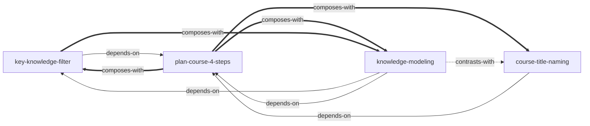

# 《换种教法：高绩效培训师精进之道》第七章 — Skill Index

> 本章由 cangjie-skill 蒸馏, 共产出 **4** 个 skills。
> 处理时间: 2026-08-04

## 关于这本书

- **作者**: 王志刚
- **出版**: 电子工业出版社, 2019 年前后
- **章节**: 第七章「课程设计四步骤」
- **一句话主旨**: 课程设计是一门科学——以"关注目标而非行为、关注关键工作而非全部工作"为底层逻辑，用"定目标 → 列知识点 → 选关键 → 结构化并命名"四步骤，让学员快速胜任。
- **整章理解**: 见 [BOOK_OVERVIEW.md](./BOOK_OVERVIEW.md)
- **精华长文** (不读全书看这篇): [DIGEST.md](./DIGEST.md) *(阶段 5 产出)*
- **术语词典**: [GLOSSARY.md](./GLOSSARY.md)

---

## Skill 列表 (按主题分组)

### 总流程

- [`plan-course-4-steps`](./plan-course-4-steps/SKILL.md) — 计划课程四步骤：从无到有的课程设计流水线（定目标→罗列→筛选→结构化+命名）

### 关键环节深挖

- [`key-knowledge-filter`](./key-knowledge-filter/SKILL.md) — 关键知识点筛选法：MECE 罗列 + 颗粒度校准 + 三指标打分，把十几个知识点收敛到 ≤6 个
- [`knowledge-modeling`](./knowledge-modeling/SKILL.md) ★ — 知识点结构化/模型化：四种方式（字母/流程/金字塔/公式）+ 选择地图 + 目标校验，把关键知识点串成易记易讲的模型

### 包装命名

- [`course-title-naming`](./course-title-naming/SKILL.md) — 课程主题命名三点式：痛点/焦点/利益点，好莱坞大片式命名（最后一步）

---

## 引用图



图例:
- `-->`  depends-on (使用前提是先理解对方)
- `-.->` contrasts-with (易混淆, 看情境区分)
- `===>` composes-with (经常配合使用)

---

## 推荐学习顺序

(从依赖图的叶子节点开始, 向上)

1. **plan-course-4-steps** — 总纲, 没有前置; 先建立"四步骤 + 两条底层逻辑"的全局观
2. **key-knowledge-filter** — 依赖四步骤的第 1 步 (学习目标); 学会收敛内容
3. **knowledge-modeling** — 依赖 filter 的输出 (≤8 个关键知识点); 本章最核心也最难的环节
4. **course-title-naming** — 最后学也最后用; 命名是课程设计的收尾动作

工作坊带教建议: 学员卡在哪一步就调用哪个 skill, 不必每次都走全链。

---

## 安装使用

本目录是构建产物, 宿主不会从这里加载 skill。要让 agent 真正调用, 把 skill 目录复制到宿主的 skills 目录:

```bash
# WorkBuddy 用户级 (所有项目可用)
cp -r plan-course-4-steps key-knowledge-filter knowledge-modeling course-title-naming ~/.workbuddy/skills/

# Claude Code 用户级
cp -r <skill-slug> ~/.claude/skills/

# 或项目级
cp -r <skill-slug> <project>/.claude/skills/
```

---

## 接入 darwin-skill

所有 skill 均带有 `test-prompts.json` (darwin-skill 兼容格式), 可直接接入自动进化:

```
"用 darwin-skill 优化 knowledge-modeling 这个 skill"
```

---

## 审计轨迹

- 候选单元池: [candidates/](./candidates/)
- 被淘汰的候选 (含原因): [rejected/](./rejected/)
- 三重验证记录: [verified.md](./verified.md)
- BOOK_OVERVIEW: [BOOK_OVERVIEW.md](./BOOK_OVERVIEW.md)
- 流水线状态: [PIPELINE_STATE.md](./PIPELINE_STATE.md)
